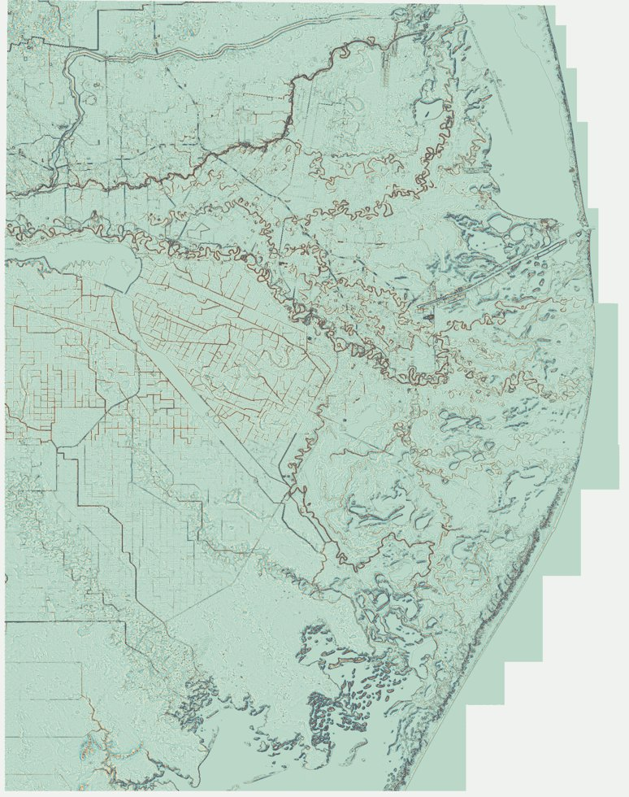

# Resaca Boundary Delineation — Interactive Map

[**🌎 Open the live interactive research map**](https://bridgettc.github.io/Resaca-Model-Map/)

Explore **44 research polygon datasets** from early rough outlines and model predictions through human-edited boundaries and **914 final mapped polygons**. The viewer includes a colorized detrended DEM, satellite imagery, layer switches, popup attributes, and a DEM opacity slider.

**Data provenance:** The published polygons are approximate, simplified web copies. The terrain layer is an overview visualization of a privately retained 5-meter detrended DEM. It is not the raw 5-meter georeferenced elevation dataset. Dataset labels distinguish historical predictions from retrospective reconstructions.

[Technical description and dataset caveats](docs/README.md)
